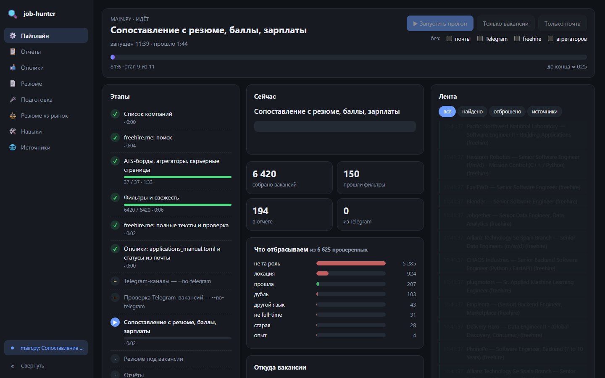
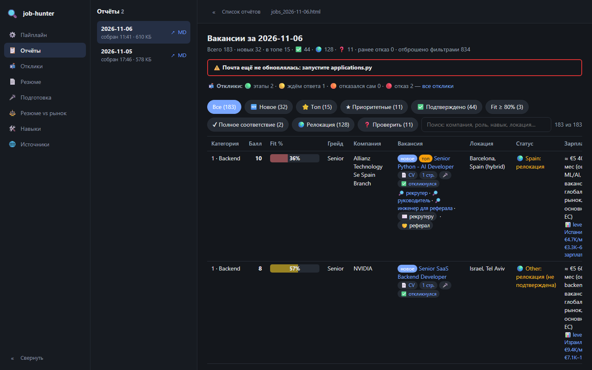
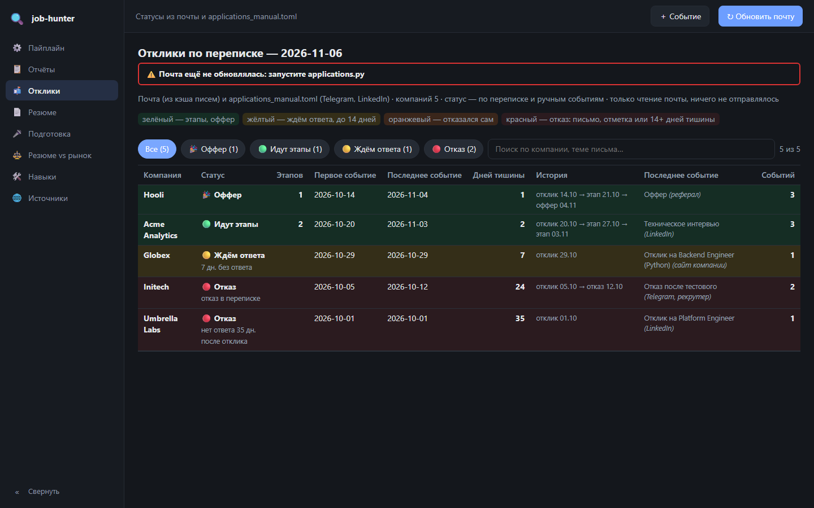
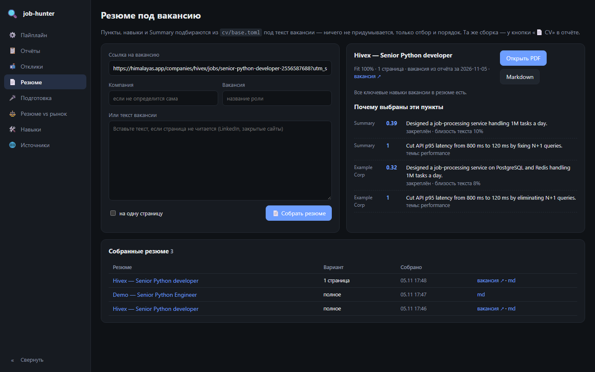
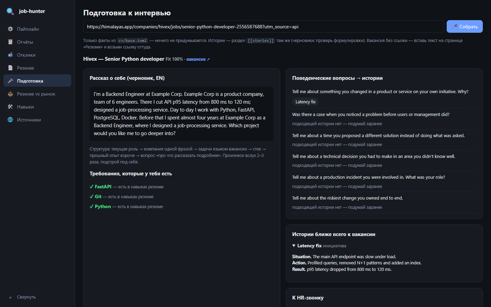
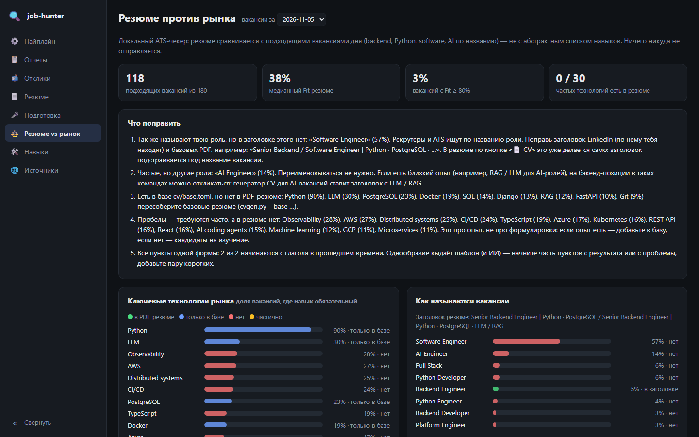
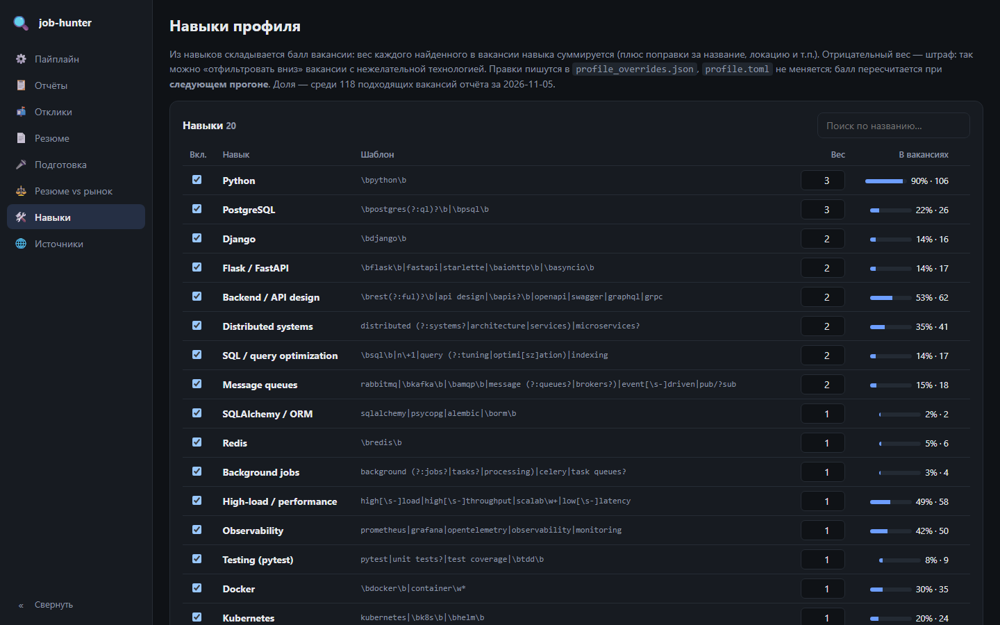
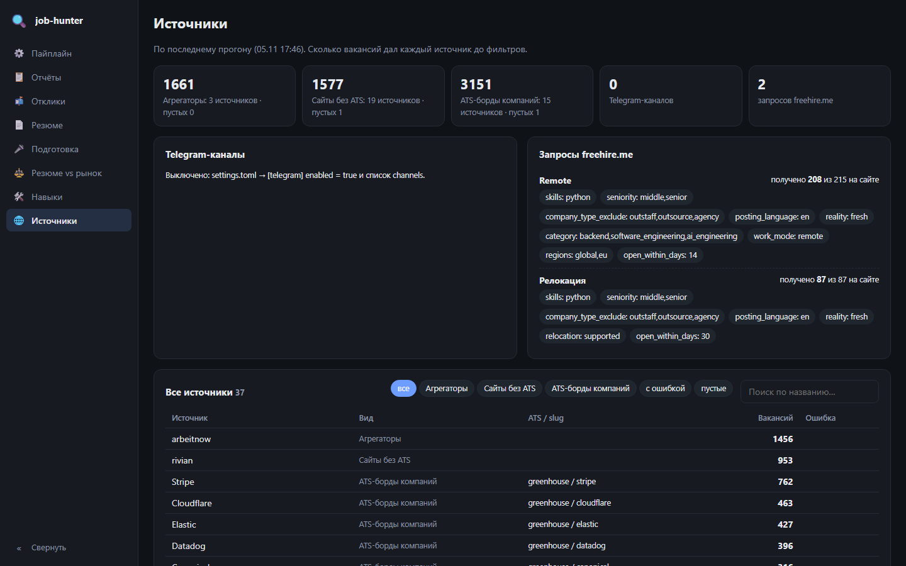

# job-hunter

A self-hosted job search assistant with a local web UI. Every day it collects vacancies from public
ATS boards (Greenhouse, Lever, Ashby, Workable, …), job aggregators, big-tech career sites,
[freehire.me](https://freehire.me) and, optionally, Telegram channels; drops the ones that do not fit;
ranks the rest against your CV and builds a report. A separate script reads your mailbox (read-only)
and tracks the status of every application. The web UI shows a live pipeline run, the reports,
your applications, builds a CV tailored to a vacancy and prepares you for the interview.

The default profile is a **Python backend engineer** looking for remote work (worldwide / Europe),
work in their home country, or relocation paid by the employer. Everything — skills, weights,
countries, sources — is configured in plain TOML files.

## What it does

- **Collects** vacancies from ~10 kinds of sources in parallel, 1 request per second per host.
- **Filters** by the full vacancy text, not just the source's labels: role, location ("remote" that is
  really "in our London office twice a week"), primary language, required experience, full-time only,
  staffing agencies. Every rejected vacancy keeps the reason and a quote from the text.
- **Ranks** by relevance to your profile (`profile.toml`), freshness and a Fit % against your CV.
- **Estimates salary**: the range stated in the vacancy, an estimate from the collected ranges, and the
  country median from [levels.fyi](https://www.levels.fyi).
- **Tracks applications** from Gmail (read-only) plus manual events (Telegram, LinkedIn, calls).
- **Builds a CV** for any vacancy from your own facts (`cv/base.toml`) — selects and orders, never invents.
- **Prepares for interviews**: requirements matched to your experience, gaps, stories for behavioural
  questions, an HR call checklist.

## Ethics and limits

- The tool **never sends anything**: no applications, no messages, no writes to your mailbox.
  Gmail access is `gmail.readonly`.
- LinkedIn is not scraped. The outreach helper only builds LinkedIn *search links* and message drafts
  for you to send yourself.
- `robots.txt` is checked before the first request to every host; disallowed URLs are skipped.
- At most 1 request per second per host (slower where a site asks for it).
- The web UI listens on `127.0.0.1` only: reports contain your mail, applications and contacts.

## Screenshots

Screenshots are taken on demo data: vacancies are public, applications and the CV are fictional.
The UI is in Russian.

| | |
|---|---|
|  |  |
| Pipeline: a live run by stages | Report: vacancies with score, Fit % and filters |
|  |  |
| Applications: statuses from mail and manual events | A CV for a vacancy and why each bullet was picked |
|  |  |
| Interview preparation | CV vs market |
|  |  |
| Profile skills and their weights | Sources of the last run |

## Quick start

You need Python 3.11+ and Google Chrome or Chromium (used to render PDF CVs). Commands are for
Windows; on Linux / macOS use `.venv/bin/python`.

```bash
python -m venv .venv
```

```bash
.venv\Scripts\pip install -r requirements.txt
```

The project runs out of the box on the example files (`*.example.*`). To make it yours, copy the
examples without `.example` — your copies are in `.gitignore`:

```bash
copy settings.example.toml settings.toml
```

```bash
copy companies.example.txt companies.txt
```

```bash
copy profile.example.toml profile.toml
```

```bash
copy cv\base.example.toml cv\base.toml
```

Start the web UI (`http://127.0.0.1:8765/`) and press "run" on the Pipeline page:

```bash
.venv\Scripts\python.exe -m web
```

Or run from a terminal — mail first, then vacancies:

```bash
.venv\Scripts\python.exe applications.py
```

```bash
.venv\Scripts\python.exe main.py
```

A quick first run on a few companies, without the slower sources:

```bash
.venv\Scripts\python.exe main.py --only "GitLab,PostHog,Supabase" --no-freehire --no-aggregators
```

The main report is `reports/latest.html`. Mail needs `gmail_client.json` — a Google OAuth client of type
"Desktop app" (see [docs/applications.md](docs/applications.md)); everything else works without it.
Daily runs via Task Scheduler / cron or Docker: [docs/pipeline.md](docs/pipeline.md),
[docs/docker.md](docs/docker.md).

## Make it yours

| File | What to change |
|---|---|
| `settings.toml` | Home country (`[home]`), relocation countries, sources, freehire queries, Telegram channels, salary threshold |
| `companies.txt` | Companies whose ATS boards are checked every run, with a priority 0–3 |
| `profile.toml` | Skills from your CV with weights and pattern, score adjustments |
| `cv/base.toml` | Facts for CV generation and interview prep: experience, achievements, skills, stories |
| `cv/*.pdf` | Your current CVs, for Fit % (paths in `settings.toml` → `[cv].files`) |

## Documentation

| File | About |
|---|---|
| [docs/web-ui.md](docs/web-ui.md) | Web UI pages, starting and skipping stages, API |
| [docs/pipeline.md](docs/pipeline.md) | Run stages, progress, `main.py` flags, daily runs |
| [docs/sources.md](docs/sources.md) | ATS boards, freehire, aggregators, career pages, Telegram, fixing `ats_mapping.json` |
| [docs/filters.md](docs/filters.md) | Filters, full-text checks, home country and relocation, languages, staffing |
| [docs/scoring.md](docs/scoring.md) | Report layout, categories, score and skills, Fit %, salaries and levels.fyi |
| [docs/cv.md](docs/cv.md) | CV generator for a vacancy, one-page version |
| [docs/applications.md](docs/applications.md) | Application statuses from mail and manual events |
| [docs/outreach.md](docs/outreach.md) | Contacts at the company and message drafts |
| [docs/interview-prep.md](docs/interview-prep.md) | Interview preparation for a vacancy |
| [docs/market-check.md](docs/market-check.md) | CV vs market: a local ATS checker |
| [docs/docker.md](docs/docker.md) | Running in Docker |
| [docs/configuration.md](docs/configuration.md) | Where things are: settings, code, data, personal files and examples |

## License

[MIT](LICENSE)
